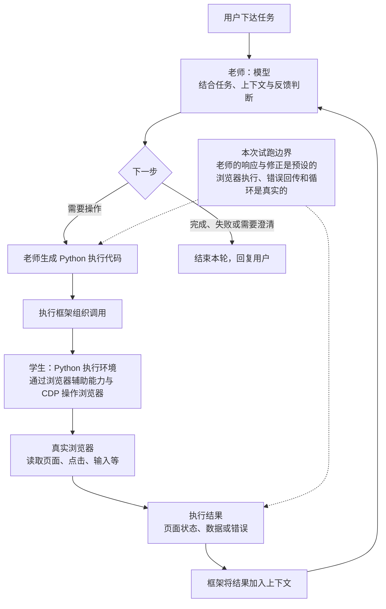

# Browser Use：浏览器中的老师与学生

日期：2026-11-12（UTC）。目标：抓核心，将既有老师—学生关联迁移到浏览器智能体。

## 材料与试跑

用户提供仓库 https://github.com/browser-use/browser-use 。AI 提炼定位、1.0 版本变化、组件和反馈循环，再按用户要求运行最小实验。依据与范围见 [S1–S4](../sources.md)。无真实模型凭据，因此使用预设模型响应；该限制在试跑前后均向用户说明。

## 用户原始解释

> 嗯 就类似老师根据任务生成执行代码 学生进行执行 反馈结果给老师 老师根据结果再循环或退出

用户在看过材料和实验结果后，自主沿用已有跨领域关联：老师生成代码，学生执行，结果反馈，老师继续或退出。不是独立延迟复测。

## 反馈与边界

AI 明确对应：老师为模型，学生为 Python 执行环境与浏览器操作能力；框架组织请求、执行和回传。浏览器本身承载页面及其变化。此组件拆分为 AI 补充，未由用户另行独立重讲。

本次老师的响应、错误操作和后续修正都是预设；学生执行与反馈链路真实跑通。没有发现需纠正的核心循环错误，没有额外补学或重讲环节；用户随后要求成图与归档。实验限制及组件拆分仍为 AI 说明，认可不等于独立解释证据。

## 本轮理解图

用户关联为主线；框架和具体技术组件为 AI 补充。图表达一般机制，不表示本次发生真实模型推理。

## 验证状态

- 循环及老师—学生关联：能解释（初步，基于已有类比迁移，在 AI 输入后自主概括）。
- Python、框架、CDP 的精确职责和 1.0 与旧版区别：已接触，未独立解释。
- 真实执行与模型自主能力的证据区别：AI 已说明，用户独立判断待验证。
- 退出不等于成功：AI 补充，应检查页面状态或产物。试跑确实检查页面，不能据此推定所有任务已被独立验证。
- 没有用户独立操作、真实模型试跑或延迟复测，不升级能应用。
