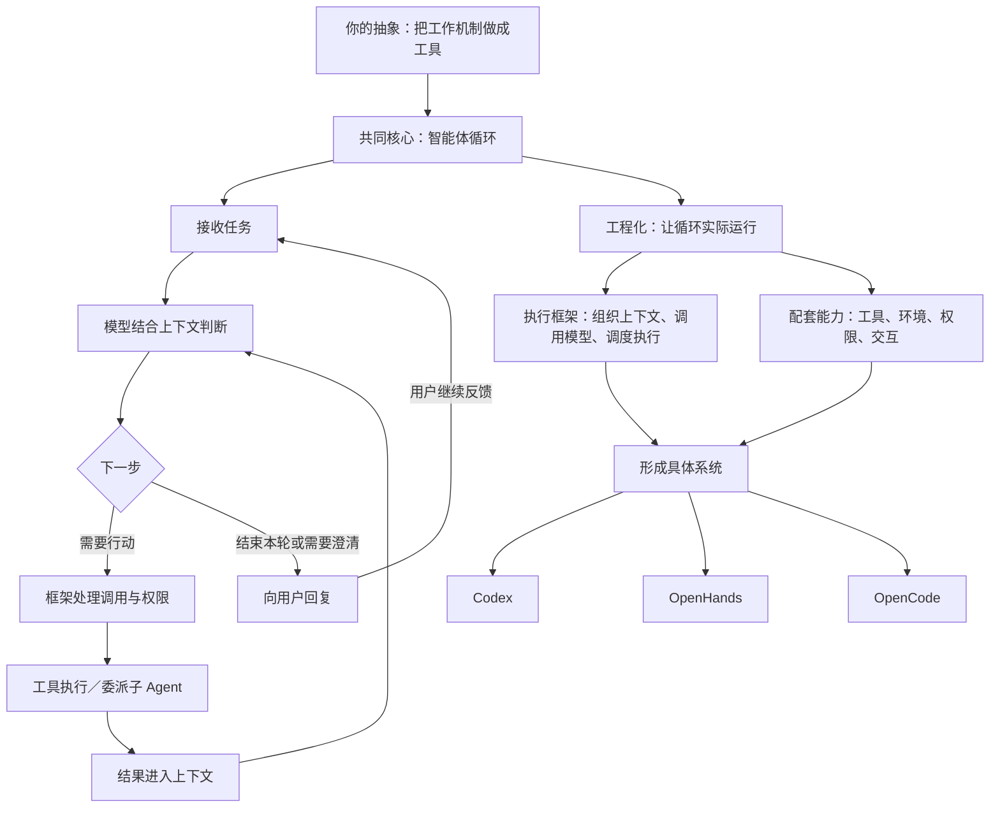

# Codex：将智能体循环工程化

日期：2026-11-12（UTC）。目标：抓住核心，继续训练抽象与关联。

## 材料与学习输入

AI 基于 [S1–S3](../sources.md) 讲解模型、执行框架、上下文、工具与环境、项目指令、Skill，并结合 [S4 索引实践](../sources.md#s4本地索引实践)。输入是 AI 提炼，未覆盖全部 Codex 功能。

## 用户原始表达

用户针对“Codex 结合指令与材料组织工作”提问：

> 这个就是执行框架所做的事情吧

AI 补充：执行框架加载适用指令、组织上下文、请求模型、处理工具调用与权限、回传结果；模型理解任务、提出动作并分析反馈。组织工作是二者配合，不把全部决策归给框架。

用户随后提出：

> 所以codex就是上面学习openhands中智能体循环的流程或者说是方法，制作成执行框架。说把方法论做成了工具

这体现用户从多个具体系统提取共同机制，并关联到“把方法做成工具”。没有新增生活类比，不编造。

## 校准与重讲状态

AI 依据 [S1](../sources.md#s1智能体循环与执行框架) 校准范围：执行框架将循环机制程序化；Codex 整体还包括模型接入、开发工具、上下文与交互等。“把工作机制工程化”比泛指方法论更精确。

用户随后问“好的。我是否抽象得还可以？”，并请求成图、归档。没有在这次范围补充后独立重讲；认可与成图不当作重讲证据。对该范围边界如需验证，待用户自己重讲，不强制阻止归档。

## 理解图

下图保存本轮展示版本。共同循环与“工程化”是用户抽象；详细组件、分支及产品排列为 AI 补充，不代表三者实现相同。

## 证据与未决点

- 共同循环与工程化关系：能解释（初步，在 AI 材料基础上自主概括）。
- 模型和框架的职责、Codex 整体范围：已接触 AI 校准，独立重讲待验证。
- AGENTS.md、Skill 与环境权限的区别：已接触，无本轮独立解释。
- 未做用户独立应用或延迟复测，不升级“能应用”。
- 图是概念结构，不保证每轮有子 Agent，也不是三种产品源码流程的逐项比对。
- 本轮没有无依据考题；未扩展平台完整差异，不把未学实现视为用户缺口。
