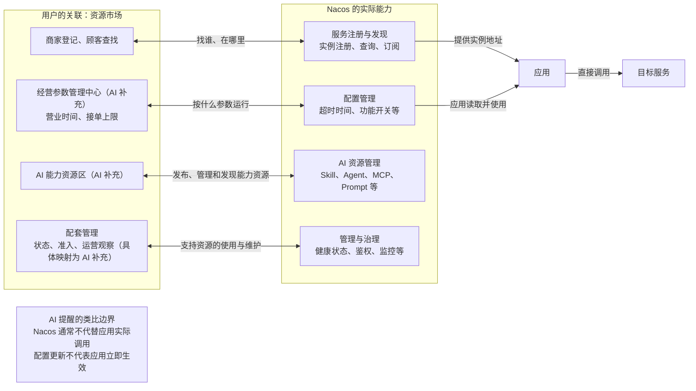

# Nacos：核心抽象与市场关联

- 归档日期：2026-11-10（UTC）。此前互动跨会话进行，不推定每条消息的精确日期。
- 目标：抓住核心，训练抽象与跨知识、跨事物关联，不要求逐项掌握。
- 来源：[S1](../sources.md#s1nacos-概览)。

## 用户原始表达

> 通过api、sdk，由命名空间对服务、配置、ai相关应用进行隔离管理

> nacos 管理服务、配置、ai资源；可发现注册服务；nocos像个资源调配市场一样，服务通过它可以注册或发现调用其他服务，它还提供出来了一些针对这些服务的附属服务？

用户随后问：

> 配置管理能在我的关联中哪一个位置呢

并要求：

> 按照这点重新画图

> 加上nacos原本的那样对比是不是更好

## 验证与反馈

- 用户提出“资源调配市场”，并识别登记、发现和配套管理结构。
- AI 提醒：发现服务通常是获取实例信息，实际请求由应用发起；不要从“调配”推导出 Nacos 代为调用。
- AI 将配置管理映射为“经营参数管理中心”，用营业时间、接单上限对应运行参数；这个具体类比由 AI 提出。
- AI 提醒：应用需要读取并使用配置，更新不等于立即生效。
- AI 将 AI 资源管理补充为市场中的能力资源区；并将用户的“附属服务”细化为健康状态、权限和监控等。
- 用户请求整合和对照图，表示愿意采用该表达形式；未独立复述或检验全部补充关系。

## 本轮理解图

这是 AI 根据用户关联绘制的结构化表达，不能将全部节点视为用户独立产生的知识。

## 证据、状态与限制

- 核心能力与市场结构：已有用户用自己的话解释的证据，可记“能解释（初步）”。
- 配置管理类比、实际调用边界：AI 补充，用户独立理解待验证。
- 关联图：已形成；不是运行结果或迁移应用证据。
- 本轮以反馈、追问类比位置和改图完成，没有新增验证题作答；不声称完成了独立应用验证。
- 实验：未运行。延迟复测：未进行。

## 下次入口

在新场景中，让用户自行选择或构造关联，并说明共同结构和失效边界。无需覆盖全部 Nacos 技术细节。
