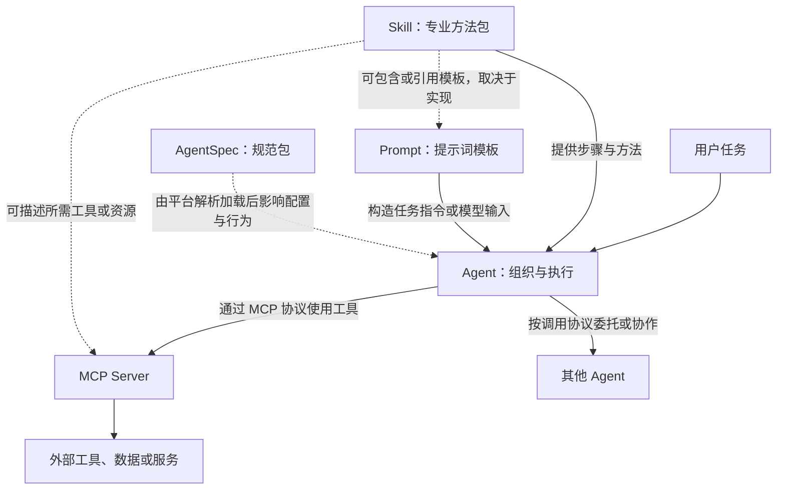

# Nacos AI 管理中心：AI 专区与资源关系

- 归档日期：2026-11-10（UTC）。
- 学习目标：抓核心，练习抽象与跨领域关联。
- 来源：[S2](../sources.md#s2ai-管理中心概述)。

## 用户原始解释

> AI资源管理中心 就像是资源市场里面的专用区域，专门管理AI资源；发现的对象分两种方式RAD只找agent，ARD所有到资源都能找。skill像是一个个技能包，一个个专业工具方法；agent像是智能人？如果觉得好用就可以去装上去用。而prompt模版是agent和skill都能使用的。当然，agentSpec可以约束agent

## 验证反馈（AI 提供，未经过独立复测）

- “资源市场中的 AI 专区”延续并细化了用户原来的市场关联。
- RAD 面向 Agent；本文列出的 ARD 搜索范围为 Agent、Skill、Prompt、MCP Server，不能推广为所有资源。
- Skill 的技能包类比合适；Agent 的可调用入口与本地安装包需要区分。
- Prompt 如何被 Agent 或 Skill 使用取决于集成，本文未规定自动依赖。
- AgentSpec 是规范包；是否约束实际执行取决于使用它的平台，不能仅因规范存在而假设强制执行。

## 用户要求与图示修订

用户询问“如果按照你的抽象与类比，你会如何”。AI 补充了“能力供应体系”和“专业服务产业园区”的类比，将 Skill 对应作业方法包、Agent 对应专业团队、MCP 对应工具服务站、Prompt 对应任务单模板、AgentSpec 对应规范说明书。

用户指出：“这几个资源之间的关系并没有体现”。随后 AI 将分类图调整为围绕任务执行的组合关系图。这次修订提示：图应表达角色之间如何连接，不能只展示分类对应。

## 资源关系图（AI 补充）

以下是可能的应用组合模型，不是原文规定的固定依赖，也不是用户已独立解释的关系。图中实线仅表示模型内的关系，虚线强调可选或依赖平台实现；所有连接仍受具体应用实现约束。

## 关系边界

- 各类资源可独立存在，Agent 不必依赖图中全部资源，Skill 也不必依赖 MCP。
- Nacos 提供资源管理与发现；登记资源不等于自动组装出执行流程。
- 资源定义上线不保证端点实际可用。
- 用户回复“嗯 先归档”，授权保存当前讨论，不等同于独立掌握 AI 补充内容。

## 当前证据与下一步

用户有 AI 专区和技能包的初步解释证据。ARD 范围、Agent 使用方式及资源关系经 AI 反馈后，尚无用户独立复述、新场景应用或延迟复测。没有运行实验。下一步可按需由用户构造一个实际任务，说明所需资源和连接；本轮先结束。
