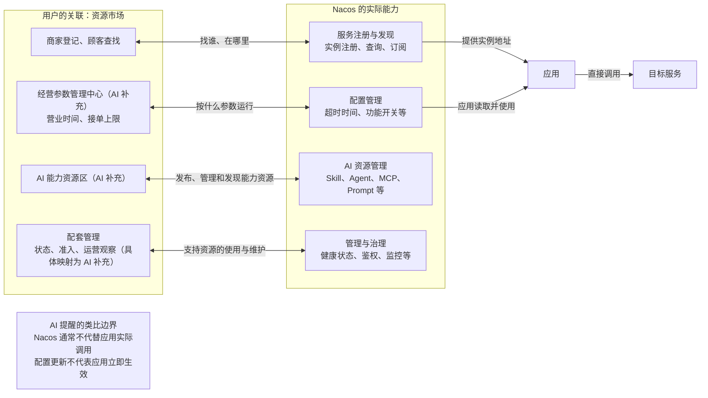

# Nacos：当前理解

- 更新日期：2026-11-10。
- 依据：[官网来源 S1](sources.md#s1nacos-概览)、[学习会话](sessions/2026-11-10-01.md)。

## 用户核心抽象

用户识别出 Nacos 管理服务、配置和 AI 资源，以及注册、发现与隔离管理等关系。参见[原始表达](sessions/2026-11-10-01.md#用户原始表达)。

## 跨领域关联

用户将 Nacos 联想到“资源调配市场”：登记供给、寻找供给，以及配套管理。这是本轮主要的自主关联成果。

配置管理对应“经营参数管理中心”、AI 资源对应“能力资源区”，由 AI 补充。用户要求将其整合为对照图；不据此认定所有对应均已独立掌握。

## 对照理解图

图源与反馈依据见[本轮会话](sessions/2026-11-10-01.md#验证与反馈)。市场一侧是类比，不是 Nacos 官方模型；配置、AI 资源区及具体治理映射由 AI 补充。

## 边界与待验证

AI 已提醒但尚未由用户独立检验：发现不等于代为调用；配置修改不保证应用立即生效。命名空间隔离是否等于权限控制，也未展开。见[证据与限制](sessions/2026-11-10-01.md#证据状态与限制)。

## 当前证据

核心抽象有初步解释证据；没有独立迁移测试、运行实验或延迟复测，不记“能应用”或“复测通过”。

## 下次复测问题（不附答案）

给定一个陌生系统，你能否找出类似登记、查找、参数管理的结构？原来的市场类比在哪些地方失效？可按用户兴趣选择新场景，不强制实施。

## 重要修订

2026-11-10：首次归档；记录用户市场关联、AI 配置类比补充及调用边界，不覆盖原始表达。
