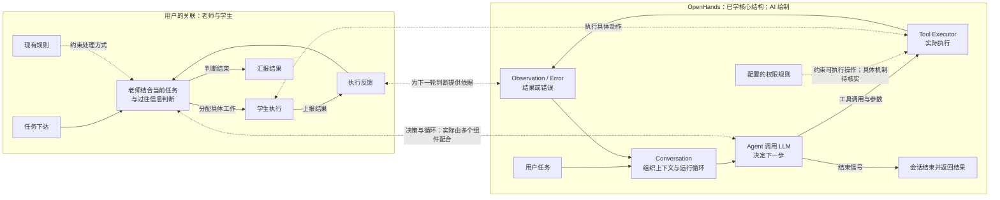

# OpenHands：执行反馈闭环与老师—学生关联

- 日期：2026-11-12（UTC）。
- 目标：抓住核心结构，训练抽象与跨领域关联。
- 材料：[官方与源码](../sources.md)、[脚本化试跑](../evidence/results.json)；此前已补充与 Codex 对照。
- 本轮闭环：完成一次提示后重讲；无延迟复测。权限分支仅保留一般规则边界，未验证产品具体实现。

## 用户初次解释（原话）

> openhands 核心是大模型解读输入的任务或以往对话、结果与当下描述，再判断是否调用平台原有的某些tool或自定义的tool，核心是大模型对tool的调用以及上下文再调用大模型（反馈？）。agent是一个个定义好相对专职的智能体，平台拥有有限的智能体编排能力。

## 验证与材料依据

AI 根据[源码与实验 S2、S3](../sources.md)区分模型提出工具请求和执行器实际操作；指出“相对专职”取决于配置，“有限编排”的范围尚未核实。

AI 问：模型只回复文件已创建，但没有工具执行，是否完成本次文件任务？用户答：

> 不会视为完成..

这支持用户在当前情境区分文字声明与实际结果；用户未自行进一步说明理由，AI 提供了“核对真实文件”的补充。该证据不升级为全面迁移应用通过。其他场景可能有用户手动创建等不同执行路径，不推广为所有文件必由特定工具创建。

## 用户自主跨领域关联（原话）

> 学生充当tool，老师接受到任务，分配给不同学生，老师经过反馈判断是否完成任务

AI 辅助细化：老师的判断与循环对应多个组件配合；学生只类比工具的执行职责，不包含其全部自主学习能力，也不代表每个工具是独立 Agent。

## 权限情境与边界修正

AI 提出学生创建文件时反馈无写入权限的情境。用户答：

> 老师可以选择授予或宣告失败，但这得向上级请示。

AI 说明老师未必能自行授予权限，也不是每次失败都需要请示。是否申请审批、谁批准依赖配置，批准不保证实际操作一定成功。本情境没有经过 OpenHands 权限实验，不能把它作为产品标准审批流程。此处是一般规则边界提示，不认定用户不懂尚未提供的产品机制。

## 用户重讲（原话；提示后完成）

> 任务下达，老师分析判断任务分发给学生，学生执行上报执行结果，老师根据结果以及过往任务和当下任务进行判断后续。如果学生反馈没有权限，老师根据现有规则处理。

## 具体变化

用户把任务下达、决策、执行、上报、历史与当前信息、后续判断串成循环；权限处理改为依据现有规则，没有指定未经证实的授权链。老师—学生关联由用户提出；组件命名映射和边界反馈由 AI 补充。重讲是在反馈后完成，不标为无提示独立复测。

## 本轮理解图

AI 根据用户原话绘制；虚线连接为类比对应或边界提醒，不表示未经实验的审批流程已被证实。

## 状态与未决点

- 核心执行反馈结构与跨领域关联：能解释（提示后重讲，有原话证据）。
- 工具声明与实际结果：有一次简单情境判断证据，不作为完整应用测试通过。
- 权限审批和多 Agent 编排范围：待查证，不列为用户待重讲任务。
- 真实模型自主规划与纠错、系统整体成功率：未验证。
- 用户通过“嗯，可以归档了吗”结束本轮，不追加考问。
