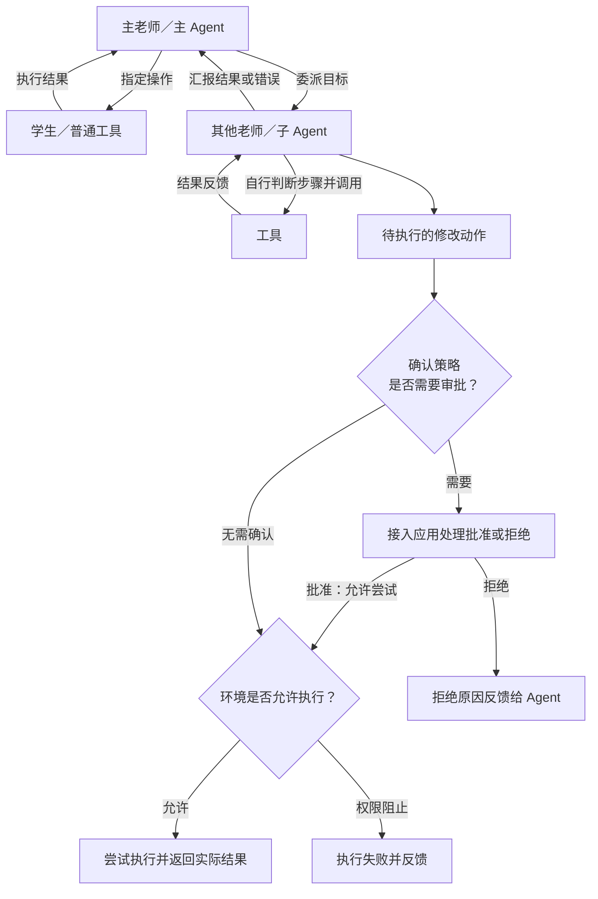

# OpenHands 第二轮：子 Agent、动作审批与环境权限

- 日期：2026-11-12（UTC）。
- 目标：扩展第一轮老师—学生关联，区分工具与子 Agent、动作审批与实际权限。
- 来源：[S6、S7](../sources.md#s6权限确认与多智能体编排的补充核实)。
- 本轮状态：完成提示后的局部重讲；无独立迁移验证或延迟复测。

## 新增学习材料与依据

[核实报告](../evidence/permissions-and-orchestration.md)将原来的待查项细化为已读源码和实际试跑证据：执行前确认策略、子任务委派及恢复、工作流组合、子会话与工作目录关系。确认策略不自动赋予系统权限。真实多模型编排尚未试跑。

## 用户自主扩展关联（原话）

> 调用工具像是交给学生执行，委派子Agent像是给其他老师？

AI 反馈：学生在此只对应执行具体操作；其他老师对应接到目标后可独立判断步骤、调用工具，再返回结果的子 Agent。现实学生的自主性不全部映射到普通工具。

## 验证问题与初次作答

AI 问：其他老师获准修改文件，但文件柜仍锁着，“获准”和“锁着”分别对应什么？

用户答：

> 子agent和没有权限

AI 定点补充：“获准”对应动作通过审批；子 Agent 对应执行任务的老师；“锁着”对应环境仍阻止访问。这是基于已提供的两层控制概念做映射，不要求推演未讲的审批实现。

## 用户重讲（原话，保留输入用字）

> 对或准是子agent能够修改动作，被锁着是环境没有权限

AI 对“能够修改”作更精确反馈：获准仅表示允许尝试修改，不保证成功。用户已把审批与环境权限分开，但尚未再次独立表述“允许尝试不等于成功”。因此记为提示后初步解释，不把最终润色全部归入用户成果。

## 更新理解图（AI 依据用户关联绘制）

## 图的边界

- 审批分支是概念流程图，不承诺所有部署一定由人审批；当前源码子任务没有确认处理器时可直接继续，需检查接入配置。
- 环境允许后也只是尝试执行，可能因其他原因失败。
- 子 Agent 有独立会话，不代表独立文件系统；当前任务实现可能共享工作目录。这一文件柜边界由 AI 提醒，尚无用户独立重讲。
- 权限试跑使用真实 SDK、自定义写文件工具与模拟模型回复；没有验证操作系统提权或真实子 Agent 协作。

## 本轮变化与状态

用户将执行类比扩展到普通工具与自主子任务的分工，并在提示后区分“获准”与“环境允许”。第一轮的“编排范围待查”已获得具体材料，不再笼统标为完全未知；仍待验证的是部署级审批接入、文件隔离配置和真实协作效果。

用户要求“嗯，归档”，本轮结束；不再强制追问或追加重讲。
