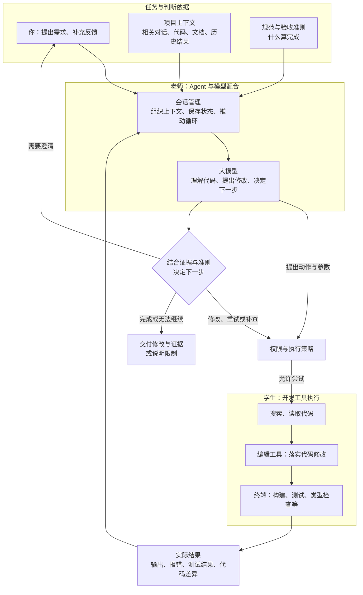

# 第三轮：将通用智能体循环抽象到 AI coding

- 日期：2026-11-12（UTC）。
- 学习目标：理解 OpenHands 与 Codex 为何能用于软件开发，把新增材料关联回原有结构。
- 依据：[S2、S3](../sources.md#s2software-agent-sdk)、[S8](../sources.md#s8ai-coding-机制的新增资料)。
- 状态：完成一次提示后局部重讲与用户自主概括，无独立延迟复测；本轮没有新运行实验。

## 学习输入（AI 提炼）

编程任务的执行能力来自模型能力与运行系统配合：相关项目上下文、开发工具、测试和用户反馈、状态与权限管理。编程能获得编译、测试、日志等外部反馈，是其便于构建验证循环的原因之一；这是综合解释，不是所有软件任务都容易验证的定律。

## 用户初次解释与关联（原话）

> 模型能力相当于老师大脑？ 项目上下文包括对话上下文、项目文件、软件开发流程中各个流程结果等，工具执行相当于学生，有的写代码，测试等；验证反馈也是老师根据各个学生执行结果进行

## 定点反馈与重讲

AI 提醒：老师的持续工作还需会话循环；模型当轮拿到的是相关上下文，不是整个项目自动全部进入模型。模型通常提出代码修改，编辑工具落实到文件，测试工具产生检查结果。

AI 请用户补完：验证结果从哪里来，老师拿到后做什么？

用户答（提示后重讲）：

> 测试等工具以及外部输入例如交互中的我，录入提前规范好的准则等。老师拿到后再判断下一步是完成还是失败，还是重试等

用户主动扩展了用户反馈和准则。AI 进一步区分：准则定义什么算完成，工具与用户反馈提供实际表现的证据，模型据此决定后续。测试通过只覆盖被测条件，宣布完成不等于实际验收。

## 用户再次抽象（原话）

> 嗯。其实他们的底层逻辑，流程都和之前理解的一致。他们这是把编程这个场景下做了智能体工具封装，做了项目上下文优化管理等

这体现用户把新增场景归入已有的决策、行动、反馈循环，而非另记一套组件。AI 补充模型的工程能力和可执行、可验证的环境，使这份解释更完整；不把补充全部视为用户独立表达。

## 场景图（AI 基于用户表达绘制）

## 图的边界

- 读取、编辑、验证是典型路径，不是 OpenHands 或 Codex 所有任务的固定执行顺序；可以重复、跳过或返回。
- 模型提出行动，执行器产生实际变更；过程反馈不自动改变模型参数。
- 项目上下文是实际获取并组织的信息，不等于始终读过全仓库。
- 成功检查、测试通过或模型宣布结束，都不构成全系统正确的保证。
- 图中会话管理、权限入口和具体工程步骤由 AI 辅助组织，不将全部节点当作用户独立作答。

## 变化、状态与未决点

- 场景抽象：有用户自主概括和提示后重讲证据，记“能解释（提示后整合）”。
- 用户反馈与验收准则：用户主动提出；“准则与证据的区分”经 AI 明确，未再次独立复述。
- 未开展真实模型的编程效果对照、训练过程验证或延迟复测，不升级为能应用或复测通过。
- 用户要求归档，本轮结束；日期未指定的复测仍待安排。
