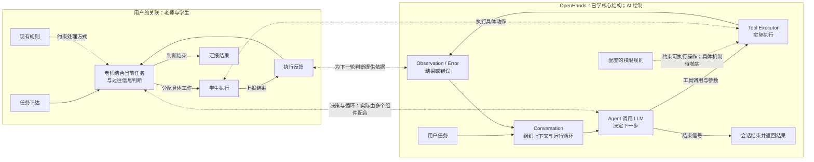
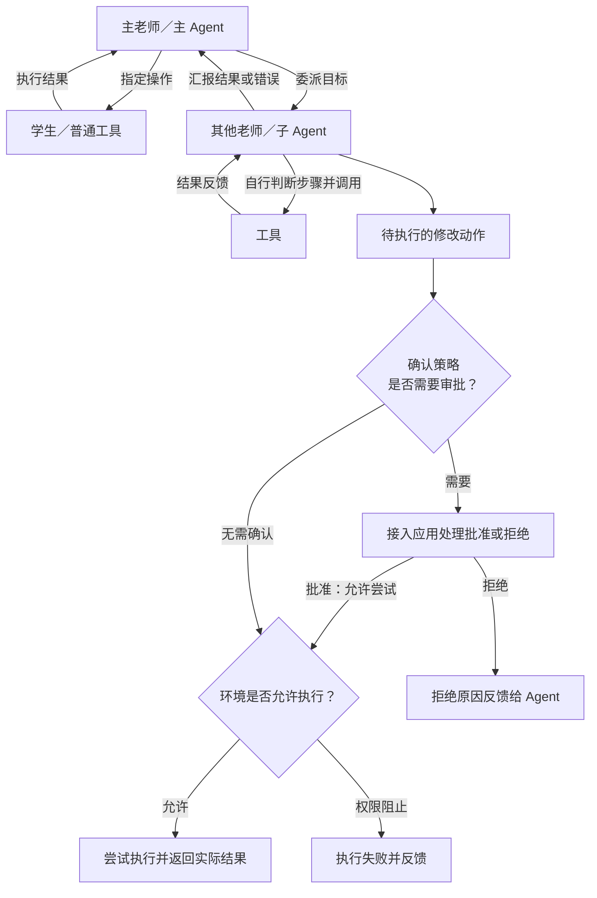
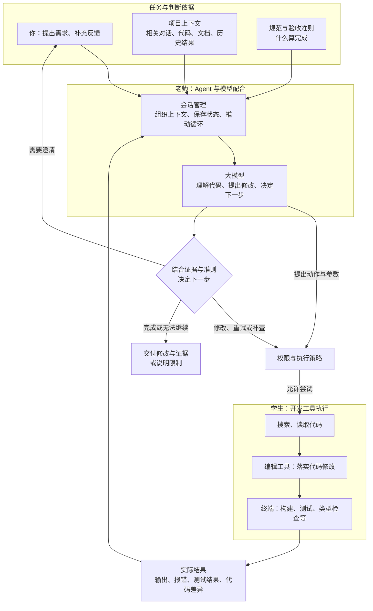

# OpenHands：当前理解

- 更新日期：2026-11-12（UTC）。
- 范围：核心执行反馈结构与自主类比，不要求全面掌握产品细节。

## 用户当前解释

用户[提示后重讲](sessions/2026-11-12-01.md#用户重讲原话提示后完成)：任务下达，老师分配学生执行，学生上报，老师结合结果、过往与当下任务判断后续；权限问题依照已有规则处理。

## 核心结构与依据

根据[SDK 源码 S2](sources.md#s2software-agent-sdk)：Conversation 管理会话循环与上下文，Agent 调用模型进行决策，工具执行器实际执行，结果或错误作为后续上下文。用户已抽象出这一反馈关系；具体技术角色名称由 AI 辅助对应。

[最小实验 S3](sources.md#s3最小试跑的本地证据)验证了真实写文件和反馈入下一轮模型请求，但模型回复被脚本替代，不证明自主纠错。Canvas 是交互入口，与后端执行层分开，见[S1](sources.md#s1openhands-主仓库与架构)。

## 用户关联与理解图

老师—学生关联由用户提出；图由 AI 根据其解释绘制。

## 类比边界与来源边界

- 老师不是单独对应 LLM，其职责由会话、Agent 和模型共同承担。
- 学生只对应执行角色，学生的自主思考不能全部迁移到普通工具。
- 第一轮的权限和编排待查项已由第二轮补充，详见下文；图中的一般规则边界仍适用。
- 与 Codex 的对照是架构与用法对照，未做模型能力、性能或成本对照实验，见[S4](sources.md#s4与-codex-对照的官方资料)。

## 与 Codex 的对比（AI 整理的学习输入）

完整表格与来源已补入[独立对照笔记](comparison-codex.md)。核心：二者都有执行与集成能力，差异主要在组件组织和配置取向；Canvas 还可以接入 Codex，不能把两者简单分成平台与模型。没有性能或成本胜负结论。本部分尚无用户独立重讲，不提高掌握状态。

## 费曼解释闭环证据

[本轮记录](sessions/2026-11-12-01.md)保留初次解释、简单情境判断、自主类比、反馈与提示后重讲。用户在重讲中主动整合历史信息和规则边界，记为“能解释（提示后）”；尚无延迟复测或独立复杂任务应用证据。

## 第二轮新增：子 Agent 与两层权限

依据：[第二轮会话](sessions/2026-11-12-02.md)、[核实报告](evidence/permissions-and-orchestration.md)与[动作确认实验](evidence/security-results.json)。

### 用户关联与提示后理解

用户将调用普通工具关联为“交给学生执行”，将委派子 Agent 关联为“交给其他老师”；后者能接收目标、自行判断、调用工具并汇报。权限部分经提示后区分了动作获准与环境无权限。AI 再补充“获准只是允许尝试”，尚无用户对这句话的独立重讲。

### 当前已知与验证边界

- SDK 支持执行前确认、拒绝反馈；批准和拒绝路径已用脚本化模型试跑。
- 源码和文档支持 Task 委派、结果返回、任务恢复，以及并行、汇总、流水线组合；未做真实多模型实验。
- 审批由接入方式处理，不是固定上级链。子任务无确认处理器时可直接继续，需按具体部署检查。
- 子会话独立不保证文件隔离；环境允许不保证动作一定成功。

## 第三轮新增：AI coding 的场景抽象

依据：[第三轮用户解释与重讲](sessions/2026-11-12-03.md)、[S8](sources.md#s8ai-coding-机制的新增资料)。

用户将模型能力对应老师的大脑，将上下文扩展到对话、项目文件及开发结果，将工具对应执行工作的学生；并主动加入用户反馈、准则和完成／重试判断。之后用户进一步概括：OpenHands 与 Codex 沿用原有底层循环，对编程场景封装工具并管理项目上下文。

AI 补充：模型通常提出修改、工具实际落实；相关上下文不等于全项目始终在模型中；准则定义目标、执行结果提供证据；还需模型工程能力及可运行验证的环境。用户已完成提示后整合，不把全部 AI 补充计为独立掌握。

该图是典型开发过程的概念表达，不是强制顺序；测试通过与模型宣布完成都不等于实际验收通过。当前记“能解释（提示后整合）”，无新实验或延迟复测。

## 可选复测入口

不看图解释每一步由谁承担，给一个执行结果不符合预期的新场景，并说明如何把反馈用于下一步判断。仅依据已学的反馈结构，不要求推演未经提供的审批或编排机制。

## 重要修订

2026-11-12：首次归档，保留用户原始类比和重讲，明确 AI 补充与实验边界。

2026-11-12：按用户提醒补全独立 Codex 对照笔记，并与来源、主题索引关联。

2026-11-12：第二轮归档，增加子 Agent 关联、两层权限图和 S6/S7 证据，保留第一轮原图与记录。

2026-11-12：第三轮归档，增加 AI coding 场景抽象、用户重讲、流程图与 S8；保留前两轮证据。
