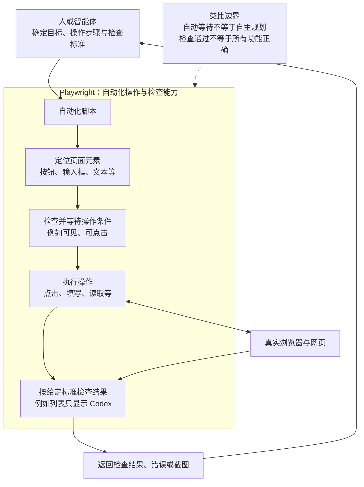

# Playwright：将浏览器操作与检查封装成能力

日期：2026-11-12（UTC）。[材料与范围](../sources.md)。

## 用户原始解释与反馈

用户提供仓库后，AI 提炼自动化、测试、定位、自动等待和断言，并比较 Browser Use。

用户原话：

> 那其实playwright 就是一个自动化浏览器 测试的工具，可以被computer use调用

AI 校准：若 computer use 指操作计算机的智能体，可以调用 Playwright；若指截图与鼠标键盘驱动的特定工具，两者可为不同执行路径，不保证互相调用。Playwright 可以通过页面元素和浏览器接口操作。

用户随后表述：

> 懂了，playwright是更为专业的，基于截图会有一定限制

AI 补充边界：浏览器专用接口便于元素定位与状态检查；截图方式受分辨率、遮挡、布局变化等影响，但能覆盖桌面应用及缺少可用元素的界面。未实测优劣，不形成所有场景性能结论。

用户又说：

> 这playwright 我找不到点抽象

并请求“你举些例子吧”，随后要求“成图”。

## AI 提供的抽象与类比

以下均为 AI 示范，不记为用户自主联想：

- 抽象：将对环境的操作与检查封装成可重复调用的能力。
- 机床与加工程序：明确步骤交给设备执行；自动执行不等于理解业务目标。
- 带清单的质检员：检查给定标准；不保证全部正确。
- 标准控制面板：提供接口，隐藏部分底层细节；操作仍可能失败。
- 组合示范：按程序操作网页、按清单检查结果的自动化设备。

用户尚未对这些类比独立加工或重讲。保存示范与图即可归档，不把请求成图视为掌握证据。

## 理解图（AI 示范）

图为自动化加检查的一种组合流程，不表示每个 Playwright 脚本都有断言、截图或外层模型循环。内部节点 B 与 Playwright 的位置是概念分组，脚本由调用者提供，不是 Playwright 必然自行生成。

## 当前证据

- 自动化与测试定位、可被智能体调用：能解释（初步，AI 材料后自主概括）。
- 元素接口与截图方式的精确区别：已接触反馈，用户有简短概括，边界仍待验证。
- 封装抽象、跨领域类比及图：AI 示范，用户独立表达待验证。
- 没有本轮独立应用、性能实验或延迟复测。

## 后续输入

用户提供 LangGraph 链接，随后要求“先归档”。本轮先保存 Playwright，LangGraph 仅进入待学习链接，不标记已读。
